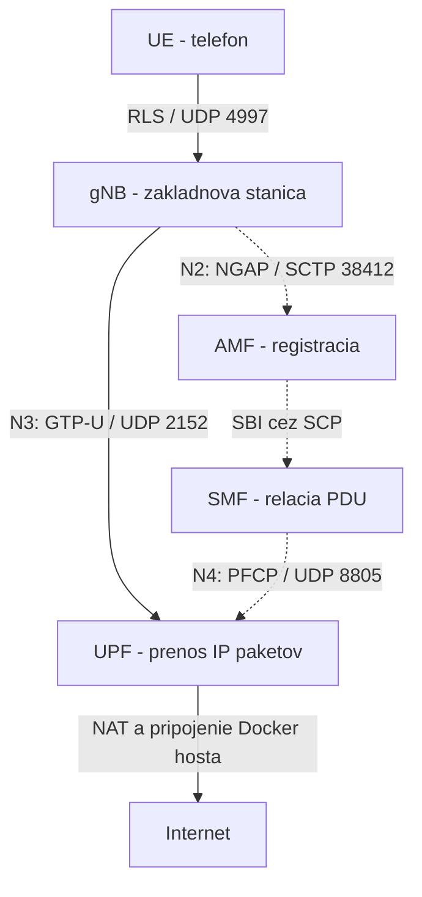

# Open5GS_teamproject

Vyukove prostredie 5G SA: Open5GS + UERANSIM. Overena verzia s Docker Compose
je dostupna vo vetve `main`.

Obsah:

- [Ako lab funguje](#ako-lab-funguje)
- [Instalacia a spustenie](#docker-compose-overena-konfiguracia)
- [Meranie TCP a UDP](#6-meranie-tcp-a-udp-v-aktivnom-labe)
- [Protokol overeneho merania](docs/measurements/compose-2026-10-21.md)

## Ako lab funguje

Lab vytvara softverove prostredie 5G SA: UERANSIM simuluje telefon (UE)
a zakladnovu stanicu (gNB), Open5GS zabezpecuje jadro siete. Mozeme sledovat
registraciu ucastnika, vytvorenie datovej relacie a prenos IP paketov.
Radiove rozhranie UERANSIM je simulovane cez UDP; lab neposkytuje plnu
simulaciu fyzickej vrstvy 5G NR. Namerane rychlosti preto charakterizuju
toto softverove prostredie a vykon VM.

### Ulohy jednotlivych casti

| Cast | Uloha v labe |
| --- | --- |
| UE | Softverovy telefon; cez rozhranie `uesimtun0` odosiela a prijima IP pakety. |
| gNB | Softverova zakladnova stanica medzi UE a jadrom Open5GS. |
| AMF | Riadi registraciu, pripojenie a mobilitu UE. |
| SMF | Riadi datovu relaciu PDU a nastavuje spracovanie paketov v UPF. |
| UPF | Spracuva pouzivatelske pakety a zabezpecuje ich prechod do externej IP siete. |
| AUSF, UDM, UDR | Zabezpecuju overenie identity a spracovanie udajov ucastnika. |
| NRF, SCP | Umoznuju vyhladavanie sietovych funkcii a sprostredkovanie komunikacie medzi nimi. |
| PCF, NSSF, BSF | Podporuju pravidla siete, vyber slice a evidenciu vazieb na sluzby. |
| MongoDB, WebUI | Databaza uchovava udaje; cez WebUI vytvarame a upravujeme ucastnika. |

### Riadenie siete a prenos dat

**Riadiaca rovina (control plane)** organizuje registraciu a relaciu PDU.
**Pouzivatelska rovina (user plane)** prenasa pakety aplikacii, napr. ping
alebo iperf3. Schema oddeluje tieto dve ulohy:



Plne sipky ukazuju prenos dat v smere UL; v smere DL sa data vracaju
opacne. Prerusovane sipky oznacuju riadiace vztahy. Schema je zjednodusena:
pomocne funkcie a odpovede na riadiace spravy nie su zakreslene.

GTP-U prenasa povodny paket v tuneli medzi gNB a UPF. Vonkajsi prenos je
UDP na porte 2152, aj ked je vo vnutri paket TCP alebo ICMP. Preto vidiet
UDP v zazname `tcpdump` automaticky neznamena, ze bezi test UDP.

### Od spustenia po prvy paket

1. gNB nadviaze spojenie s AMF a dokonci postup NG Setup.
2. UE najde gNB a zacne registraciu do siete. Jadro overi identitu ucastnika.
3. UE poziada o relaciu PDU pre DNN `internet`. SMF riadi jej vytvorenie
   a nastavenie UPF.
4. UE ziska adresu IPv4 a rozhranie `uesimtun0`. Paket z aplikacie moze prejst
   cez UE, gNB a UPF k cielu; odpoved sa vracia rovnakym datovym traktom.

Udaje UE musia zodpovedat zaznamu ucastnika v Open5GS: najma IMSI,
autentizacne kluce a parametre DNN a slice. V tomto projekte pouzivame
PLMN `999/70`, IMSI `999700000000001`, DNN `internet` a SST `1`.
Relacia PDU predstavuje datove pripojenie UE do zvolenej datovej siete.

### Preco ma UE dve adresy

| Siet alebo rozhranie | Priklad v tomto projekte | Vyuzitie |
| --- | --- | --- |
| Docker siet `core` | `172.18.0.0/24` | Prepojenie kontajnerov; gNB ma `.21`, UE `.22` a UPF `.7`. |
| UE `uesimtun0` | Napr. `10.45.0.3` | Adresa telefonu pridelena pri vytvoreni relacie PDU; moze sa zmenit. |
| UPF `ogstun` | `10.45.0.1/16` | Rozhranie IP siete ucastnikov na strane UPF. |

Adresa kontajnera UE `172.18.0.22` sluzi na komunikaciu kontajnera v sieti
Docker. Adresa `10.45.0.x` patri simulovanemu telefonu. Prikaz
`ping -I uesimtun0 ...` vyberie datovy trakt telefonu. Ping cez bezne
rozhranie `eth0` kontajnera by preveroval inu trasu.

UPF pri komunikacii do internetu preklada zdrojove adresy UE pomocou NAT
na svojom `eth0`; dalsie presmerovanie zabezpecuje siet Docker a hostitelska
VM. Ping na `10.45.0.1` overuje dosiahnutelnost UPF, ping na `1.1.1.1`
navyse overuje cestu do internetu.

### Co prinasaju Docker Compose a Git

Subor `compose.yaml` definuje sluzby, obrazy, siete, opravnenia, pripojene
konfiguracie a zvazky. Git uchovava spolocne verzie tychto suborov,
Dockerfile a skriptov. Clenovia timu tak mozu pouzit rovnaky commit
a rovnaky postup spustenia.

Kazdy clen si pripravi vlastny subor `.env` a zaznam ucastnika so zhodnymi
klucmi vo svojej databaze. `.env` nie je sledovany Gitom. Git neprenasa
beziace kontajnery ani obsah databazy; MongoDB si ho v danom prostredi
uchovava vo zvazku `mongo-data`.

Rovnaka konfiguracia nezarucuje rovnaky vykon. Vysledky ovplyvnuju CPU,
RAM, jadro Linuxu, virtualizacia a dalsia zataz. Pri porovnavani preto
zaznamenavame verzie, obrazy a rovnake parametre testu. Stav kontajnera
`Up` potvrdzuje jeho beh; funkcnost pripojenia overujeme registraciou,
relaciou PDU a skutocnym prenosom paketov.

### Co znamenaju vysledky merania

| Metrika | Vyznam |
| --- | --- |
| UL / DL | Smer UE -> UPF / UPF -> UE. |
| Priepustnost prijimaca | Kolko uzitocnych dat prijimac prijal za sekundu, v Mbit/s. |
| RTT | Cas cesty paketu ping k cielu a odpovede spat, v ms. |
| Straty UDP | Podiel stratenych datagramov z celkoveho poctu. |
| Jitter UDP | Odhad kolisania prenosoveho oneskorenia UDP datagramov, v ms. |
| Opakovane prenosy TCP | Pocet opakovanych prenosov hlasenych TCP odosielatelom. |

Meraci server je na UPF `10.45.0.1`. iperf3 preto meria usek UE - gNB - UPF;
pristup do internetu overujeme osobitne. Pri UDP sa straty hodnotia priamo,
pri TCP sledujeme opakovane prenosy. Tieto dve hodnoty nie su zamenitelne.
RTT sa v nasom skripte meria pred zatazou a jitter pochadza z testov UDP.

Predvolene testujeme TCP pri 50 Mbit/s a UDP pri 5 Mbit/s, tri opakovania
kazdeho smeru. Median je prostredna z troch nameranych hodnot. Vysledok
okolo 50 Mbit/s pri cieli 50 Mbit/s potvrdzuje dosiahnutie zadanej zataze;
neurcuje maximalnu priepustnost labu ani realnej radiovej siete 5G.

Podklady k teorii:

- [Open5GS: architektura a konfiguracia jadra](https://open5gs.org/open5gs/docs/guide/01-quickstart/)
- [UERANSIM: UE, gNB a obmedzenia simulacie](https://github.com/aligungr/UERANSIM)
- [Docker Compose: spolocna definicia prostredia](https://docs.docker.com/compose/intro/features-uses/)
- [iperf3: merania, smery a parametre](https://software.es.net/iperf/invoking.html)

## Docker Compose: overena konfiguracia

Overene 21.10.2026 na Ubuntu 22.04 x86_64 vo VirtualBoxe: 4 GB RAM,
2 vCPU a priamy pristup VirtualBoxu k VT-x.

| Komponent | Verzia / obraz |
| --- | --- |
| Open5GS | `gradiant/open5gs:2.8.0` |
| WebUI | `gradiant/open5gs-webui:2.8.0` |
| MongoDB | `mongo:6.0` |
| UERANSIM | Lokalny obraz `open5gs-ueransim:amf-fix` |
| Zdrojovy kod UERANSIM | Commit `1ae9bf2062b57595dbcbc4bc1d0a0ccf06815bac` |

Lokalny obraz pre gNB a UE sa zostavuje pomocou `docker/ueransim/Dockerfile`.
Pri spusteni UERANSIM vypisuje verziu `3.3.0`; pouzity commit obsahuje dalsie
opravy spracovania NAS a vyberu AMF.

### 1. Priprava Linuxu a repozitara

Prikazy vykonavajte **v terminali Ubuntu VM ako bezny pouzivatel**; `sudo`
je uvedene tam, kde je potrebne. Pre zopakovanie kontrolneho prostredia
pouzite Ubuntu 22.04 x86_64. Predpoklada sa pristup na internet a opravnenie
pouzivat `sudo`. Postup nevyzaduje predchadzajucu nativnu instalaciu Open5GS,
UERANSIM ani fyzicku SIM kartu.

#### Priprava nastrojov a Dockeru

Nainstalujte nastroje potrebne na pripravu, spustenie a nasledne meranie:

```bash
sudo apt-get update
sudo apt-get install -y git python3 nano curl ca-certificates build-essential iproute2 iputils-ping util-linux coreutils kmod
```

Ak Docker este nemate, najprv nainstalujte **Docker Engine, Buildx a Compose
plugin** podla [oficialneho navodu pre Ubuntu](https://docs.docker.com/engine/install/ubuntu/).
Potom overte sluzbu, Compose a pristup ku kontajnerom:

```bash
sudo systemctl enable --now docker
sudo docker version
sudo docker compose version
sudo docker run --rm hello-world
```

Pokracujte, ked Docker vypise aj cast `Server`, Compose svoju verziu a test
`hello-world` sa uspesne skonci. Samotny prikaz `systemctl enable --now docker`
Docker neinstaluje. Existujucu funkcnu instalaciu netreba preinstalovat.

#### Kontrola siete a jadra Linuxu

Lab potrebuje zariadenie `/dev/net/tun` a podporu SCTP v jadre Ubuntu VM:

```bash
sudo modprobe tun
sudo modprobe sctp
ls -l /dev/net/tun
ip -4 route
sudo docker network ls -q | xargs -r sudo docker network inspect \
  --format '{{.Name}} {{range .IPAM.Config}}{{.Subnet}} {{end}}'
```

Zariadenie `/dev/net/tun` musi existovat a prikazy `modprobe` sa musia skoncit
bez chyby. Siet projektu `172.18.0.0/24` sa nesmie prekryvat s inou pouzivanou
sietou Docker, VPN alebo lokalnou sietou. Pri novej instalacii musi byt tento
rozsah volny; pri dalsom spusteni uz moze patrit sieti tohto projektu
`open5gs-ueransim_core`. Pri kolizii najprv vyrieste adresny plan, potom
pokracujte v spusteni.

#### Stiahnutie projektu

```bash
cd ~
git clone --branch main https://github.com/steroxmq/Open5GS_teamproject.git
cd Open5GS_teamproject
cp -n .env.example .env
chmod 600 .env
```

Vsetky dalsie prikazy Compose vykonavajte z adresara `~/Open5GS_teamproject`.
Ak uz mate vlastnu kopiu repozitara, pouzite jej adresar. `cp -n` ponecha
existujuci `.env` bez zmeny. Pri pokracovani vo funkcnom labe zachovajte jeho
kluce a zaznam ucastnika; nevytvarajte nove hodnoty pri kazdom spusteni.

#### Odkial ziskat UE_KEY a UE_OPC

Pri **novej instalacii tohto izolovaneho simulovaneho labu** vytvorte vlastne
testovacie autentizacne hodnoty. Netreba ich ziskavat od operatora ani zo starej
VM. Kazdy clen timu moze mat vlastne hodnoty; rozhoduje ich zhoda medzi UE
a zaznamom ucastnika v jeho vlastnej databaze.

Tento prikaz vygeneruje dva riadky pre `.env`. Kazda hodnota ma 16 bajtov,
teda 32 hexadecimalnych znakov:

```bash
python3 - <<'PY'
import secrets
print("UE_KEY=" + secrets.token_hex(16).upper())
print("UE_OPC=" + secrets.token_hex(16).upper())
PY
```

Skopirujte **oba vypisane riadky aj s nazvami premennych**. Otvorte:

```bash
nano .env
```

Nahradte povodne riadky `UE_KEY=...` a `UE_OPC=...` skopirovanymi riadkami.
V tomto postupe pouzite hodnoty bez uvodzoviek a medzier. Ulozte cez
Ctrl+O, Enter a ukoncite editor cez Ctrl+X. Potom overte format bez vypisovania
klucov:

```bash
if grep -Eq '^UE_KEY=[0-9A-Fa-f]{32}$' .env &&
   grep -Eq '^UE_OPC=[0-9A-Fa-f]{32}$' .env; then
  echo "OK: UE_KEY aj UE_OPC maju spravny format."
else
  echo "CHYBA: opravte oba riadky v .env pred dalsim krokom."
fi
git check-ignore .env
```

Ocakavany vystup je `OK: ...` a riadok `.env`. Kontrola formatu este
neoveruje zhodu s databazou; ucastnika vytvorite v kroku 3.

| Premenna v `.env` | V sablone UE | Pri vytvarani ucastnika vo WebUI |
| --- | --- | --- |
| `UE_KEY` | `key` | `K / Subscriber Key` |
| `UE_OPC` | `op` pri `opType: OPC` | `OPc`, s vybranym typom `OPc` |

Sablona `docker/ueransim/ue.yaml.template` uz pouziva typ `OPC`; pri spusteni
sa hodnoty doplnia z `.env`. Rovnake hodnoty si ponechajte pre krok 3.
Pri migracii existujuceho nativneho UE mozete prebrat jeho `key` a `op`,
ak ma nastavene `opType: OPC`, a pouzit ich aj v novej databaze Compose.
Pri existujucom funkcnom Compose labe pouzite jeho sucasny `.env`.
Subor `.env` zostava vyluceny zo sledovania v Gite.

Ak je na tejto VM uz nainstalovany nativny Open5GS, pred spustenim Compose
zastavte jeho sluzby a jeho MongoDB. Po restarte VM sa mozu opat spustit,
preto tento krok pri navrate k Compose zopakujte:

```bash
sudo systemctl stop 'open5gs-*.service' mongod.service
```

Ak mate rucne spustene nativne gNB alebo UE, ukoncite ich v prislusnych
terminaloch cez Ctrl+C. Pre novu VM bez nativneho labu tieto kroky odpadaju.

### 2. Zostavenie UERANSIM a spustenie jadra siete

Prve zostavenie vykonajte pri zastavenych kontajneroch tohto prostredia.
Dockerfile zostavuje UERANSIM s parametrom `-j1`.

```bash
sudo docker compose config -q
sudo docker compose --progress=plain build gnb
sudo docker compose up -d mongo webui nrf scp amf smf upf ausf udm udr pcf nssf bsf
sudo docker compose ps
```

Pred dalsim krokom musi mat MongoDB stav `healthy` a funkcie jadra siete musia
bezat bez opakovanych restartov. UPF automaticky vytvori a aktivuje rozhranie
`ogstun` s adresou `10.45.0.1/16`, zapne presmerovanie IPv4 a nastavi NAT.

### 3. Vytvorenie ucastnika v novej databaze

Otvorte WebUI **v prehliadaci Ubuntu VM**: <http://localhost:9998>.
V novej databaze skript `docker/open5gs/config/mongo-init.js` vytvori ucet
WebUI `admin` s heslom `1423` pre izolovane vyukove prostredie.
Inicializacia prebehne pri prvom spusteni MongoDB s prazdnym datovym adresarom.

Prihlaste sa a pridajte ucastnika s nasledujucimi parametrami. Hodnoty
`UE_KEY` a `UE_OPC` uz mate z kroku 1 ulozene vo vlastnom `.env`. Vo WebUI
vlozte iba ich 32-znakove hodnoty, bez casti `UE_KEY=` alebo `UE_OPC=`.
Pre ich lokalne zobrazenie pouzite `nano .env` v dalsom terminali.

| Pole | Hodnota |
| --- | --- |
| IMSI | `999700000000001` |
| K / Subscriber Key | Hodnota `UE_KEY` zo suboru `.env` |
| OP type | `OPc` |
| OPc | Hodnota `UE_OPC` zo suboru `.env` |
| AMF, Authentication Management Field | `8000` |
| Slice SST | `1` |
| Slice SD | Nezadane |
| APN / DNN | `internet` |
| Typ relacie PDU | IPv4v6 |


Ulozte ucastnika. Jeho zaznam sa uchovava vo zvazku `mongo-data`; pri dalsich
spusteniach ho netreba vytvarat znova. Pri zmene klucov v `.env` upravte aj
kluce daneho ucastnika vo WebUI, aby sa hodnoty zhodovali.
Pre jeden IMSI vytvorte iba jeden zaznam. Pri chybnom kluci moze UE najst
gNB, ale autentifikacia sa neskonci uspesne; samotna dostupnost WebUI
nepotvrdzuje prihlasenie UE.

### 4. Automaticke spustenie existujuceho labu

Po zostaveni obrazu a vytvoreni ucastnika mozete cely postup spustit prikazom:

```bash
bash scripts/compose-up.sh
```

Skript pouzije sudo pre Docker, spusti jadro siete a pocka na inicializaciu
AMF, SMF a UPF. Overi pritomnost jedneho zaznamu ucastnika v MongoDB, obnovi
gNB, pocka na uspesny NG Setup a potom obnovi UE. Po vytvoreni rozhrania TUN
overi aktualny stav registracie a relacie PDU. Nakoniec posle po tri pakety
ping na UPF a internet. Obnova gNB a UE prerusi ich existujuce spojenie.

Logy, stav kontajnerov, adresa UE a vysledky ping sa ulozia do noveho adresara
`results/compose-*`. Pri chybe skript vrati nenulovy kod a vypise cestu k logom.
Kontajnery zostanu spustene. Ak zaznam ucastnika chyba, vytvorte ho vo WebUI
podla kroku 3 a spustite skript znova.

Skript ocakava existujuci lokalny obraz `open5gs-ueransim:amf-fix`. Pre nove
prostredie najprv vykonajte zostavenie z kroku 2. Limit cakania na jednu fazu
je predvolene 120 sekund a mozno ho zmenit premennou `LAB_WAIT_SECONDS`.
Moznosti zobrazi `bash scripts/compose-up.sh --help`.

Automaticky skript bol overeny 21.10.2026 na skutocnom Compose labe
s commitom `cf04c39`: UE ziskal adresu `10.45.0.3`, UPF aj internet odpovedali
na 3/3 pakety bez strat. Priemerny RTT bol 1,057 ms na UPF a 3,772 ms
na internet. Adresa UE sa pri dalsom spusteni moze zmenit.

### Rucne pripojenie gNB a UE

```bash
sudo docker compose up -d --no-deps gnb
sudo docker compose logs -f --tail=20 gnb
```

Pockajte na hlasenie `NG Setup procedure is successful`, potom stlacte Ctrl+C.
Ctrl+C pri sledovani logov ukonci ich vypis; kontajner zostane spusteny.

```bash
sudo docker compose up -d --no-deps ue
sudo docker compose logs -f --tail=40 ue
```

Pockajte na uspesnu registraciu, vytvorenie relacie PDU a hlasenie
`TUN interface[uesimtun0, ...] is up`, potom stlacte Ctrl+C.

### 5. Overenie prenosu dat

```bash
sudo docker compose exec -T upf ip -br addr show ogstun
sudo docker compose exec -T ue ping -I uesimtun0 -c 5 -W 2 10.45.0.1
sudo docker compose exec -T ue ping -I uesimtun0 -c 5 -W 2 1.1.1.1
```

Rozhranie `ogstun` musi mat adresu `10.45.0.1/16`; pri oboch testoch ping musia
prichadzat odpovede. IP adresa UE sa prideluje dynamicky, preto prikazy
pouzivaju nazov rozhrania.

### 6. Meranie TCP a UDP v aktivnom labe

Pred prvym meranim pripravte izolovany iperf3 **3.21**. Instalacny skript
spustite ako bezny pouzivatel:

```bash
sudo apt-get install -y build-essential curl ca-certificates
bash scripts/setup-lab-iperf3.sh
```

Skript overi SHA-256 oficialneho zdrojoveho archivu, skompiluje ho prikazom
`make -j1` a ulozi binarku do
`~/.local/open5gs-lab/iperf3-3.21/bin/iperf3`. Pouziva vlastnu staticku
kniznicu libiperf. Ak instalacia skonci chybou, vypise umiestnenie logov.

Po uspesnom automatickom spusteni labu spustite meranie:

```bash
sudo python3 scripts/measure-compose.py
```

Meraci skript automaticky najde binarku pouzivatela, ktory zavolal `sudo`,
a overi verziu 3.21. Klient aj server pouziju jej absolutnu cestu v sietovych
mennych priestoroch kontajnerov UE a UPF. Systemova verzia z PATH sa automaticky
nepouzije. Na Ubuntu VM musia byt dostupne Python 3 a nastroje `nsenter`, `ip`,
`ss`, `ping` a `timeout`. Verzia, cesta a SHA-256 binarky aj identifikatory
obrazov kontajnerov sa ulozia do metadat merania.

Skript overi trasu z aktualnej adresy UE cez `uesimtun0` na UPF `10.45.0.1`.
Pred zatazou odosle 20 paketov ping na UPF. Nasleduju tri opakovania kazdej
kombinacie TCP/UDP a UL/DL: spolu 12 testov po 5 sekundach. UL znamena
UE -> UPF, DL znamena UPF -> UE. Pred kazdym testom sa spusti server iperf3
viazany na adresu `10.45.0.1`, port 5202. Proces servera ma casovy limit.

Predvoleny ciel TCP je **50 Mbit/s**, ciel UDP **5 Mbit/s** a velkost datagramu
UDP 1200 bajtov. Ide o meranie pri zadanej zatazi, nie o urcenie maximalnej
priepustnosti. Kazdy test pouziva jeden datovy tok. Cely uspesny postup trva
priblizne 1-2 minuty; pri chybe sa zastavi a ulozi dostupne vysledky.

V adresari `results/iperf-*` vzniknu:

- povodne JSON a chybove vystupy klienta a servera pre kazdy test;
- `runs.csv` s hodnotami jednotlivych behov;
- `summary.json` s metadatami a suhrnnymi hodnotami;
- `report.md` s tabulkou, `ping-upf.txt`, trasa a diagnosticke logy.

Priepustnost sa uvadza na strane prijimaca. Pri UDP sa pocita zo skutocne
prijatych bajtov a casu v intervaloch prijimaca. Celkove percento strat UDP v skupine sa pocita ako
100 * sucet stratenych paketov / sucet paketov. Jitter v suhrne predstavuje
median zaverecnych hodnot prijimaca. ICMP RTT sa uvadza samostatne pred zatazou.

Parametre zobrazi `python3 scripts/measure-compose.py --help`. Pri porovnavani
pouzite zhodne ciele bitrate, trvanie, pocet opakovani a verziu iperf3.
Vypocty metrik a spracovanie chyb boli overene simulovanymi scenarmi.
Prikazy a JSON oboch smerov TCP aj UDP boli overene s iperf3 3.21 na lokalnom
spojeni. V Compose labe bola 21.10.2026 s iperf3 3.21 dokoncena cela seria:
12/12 testov, tri behy TCP UL, TCP DL, UDP UL a UDP DL, kazdy po 5 sekund.
Median prijimaca bol 49,885 Mbit/s pre TCP UL, 49,881 Mbit/s pre TCP DL,
5,000 Mbit/s pre UDP UL a 4,999 Mbit/s pre UDP DL. UDP nezaznamenalo straty;
TCP zaznamenalo spolu 52 opakovanych prenosov v UL a 46 v DL.
Presne hodnoty, parametre, identifikatory a hranice overenia su v
[zazname merania](docs/measurements/compose-2026-10-21.md).

Systemova verzia iperf3 3.9 v kontrolnej VM pocas TCP UL cakala pri ukonceni
na zvysok bloku dat, hoci sprava o ukonceni uz bola vo vstupnej fronte
riadiaceho spojenia. Izolovany iperf3 3.21 tento diagnosticky beh ukoncil
spravne pri zachovanych kontajneroch UE a UPF.

### Zastavenie a opatovne spustenie

Po skonceni prace zastavte kontajnery z korena projektu:

```bash
sudo docker compose stop
```

Prikaz `sudo docker compose stop` zastavi kontajnery. Prikaz
`sudo docker compose down` bez dalsich parametrov odstrani kontajnery a siet
projektu, pricom zachova pomenovany zvazok `mongo-data` s uctom WebUI
a zaznamom ucastnika. Pri opatovnom spusteni dodrzte poradie:
jadro siete -> gNB s uspesnym NG Setup -> UE.

Pri praci s existujucou databazou zachovajte zvazok `mongo-data`. Skript
`mongo-init.js` pripravuje ucet WebUI; vytvorenie ucastnika v novej databaze
je opisane v kroku 3.

Po restarte VM spustite Docker, prejdite do svojej existujucej kopie projektu
a pouzite overeny skript. Pri standardnom umiestneni z kroku 1:

```bash
cd ~/Open5GS_teamproject
sudo systemctl start docker
bash scripts/compose-up.sh
```

Ak mate nativne sluzby Open5GS, predtym ich zastavte podla kroku 1. Zachovajte
`.env` aj `mongo-data`: kluce, ucet WebUI a ucastnika netreba vytvarat znova.
Ak lokalny obraz este nie je zostaveny, vratte sa ku kroku 2.

### Kedy povazovat zopakovanie za uspesne

- `compose-up.sh` sa skonci hlasenim `HOTOVO` a oba testy ping maju 0% strat.
- UE je zaregistrovany, ma aktivnu relaciu PDU a IPv4 na `uesimtun0`.
- `measure-compose.py` dokonci vsetkych 12 testov. V novom `summary.json`
  su `status: "complete"`, `completed_runs: 12` a `planned_runs: 12`.
- Pri porovnani pouzite rovnaku verziu iperf3 a rovnake parametre testu.
  Presny bitrate, RTT, jitter a dynamicka adresa UE sa mozu medzi pocitacmi lisit.

Meraci skript vypise konkretny novy adresar `results/iperf-*`. Z **tohto
adresara** poslite timu `summary.json` a `report.md`; nezamienajte ich
so subormi starej alebo neuspesnej serie. Navod je pripraveny na overenie
na dalsom pocitaci, ale takyto druhy nezavisly beh este nie je potvrdeny.

### Zaznamenane vysledky

| Test | Odpovede | Straty | Priemerny RTT | Maximalny RTT |
| --- | --- | --- | --- | --- |
| UE -> UPF `10.45.0.1` | 5/5 | 0% | 0,799 ms | 1,262 ms |
| UE -> internet, 100 paketov za ~100 s | 100/100 | 0% | 3,134 ms | 7,858 ms |
| UE -> internet po opatovnom vytvoreni kontajnerov | 5/5 | 0% | 2,780 ms | 3,752 ms |
| UE -> internet po automatickom spusteni | 3/3 | 0% | 3,772 ms | 4,174 ms |

Po opatovnom vytvoreni kontajnerov sa rozhranie `ogstun` automaticky obnovilo
s adresou `10.45.0.1/16`. Test prebehol so zachovanou databazou MongoDB.
Cista instalacia na druhom pocitaci a automaticke spustenie po uplnom restarte
VM zatial neboli overene. Kompletna seria merani TCP/UDP UL/DL s iperf3 3.21
bola uspesna pri zadanej zatazi 50/5 Mbit/s. Dalsim krokom je overenie postupu
na druhom pocitaci podla tohto README.

## Nativne prostredie - vychodiskovy stav

Overene v Ubuntu VM dna 15.10.2026.
UERANSIM 3.3.0; Open5GS 2.8.0.

UE sa zaregistrovalo do siete, ziskalo adresu IPv4 a aktivnu relaciu PDU.
Test z menneho priestoru UE na adresu 1.1.1.1: 100/100 odpovedi,
0% strat a priemerne oneskorenie 6,258 ms.

Skript `scripts/demo-open5gs-ueransim.sh` spusta lokalne gNB a UE. Predpoklada,
ze Open5GS je uz nainstalovany, jeho sluzby su spustene a ucastnik je vytvoreny.
Ide o nativny variant pre kontrolnu VM, ktory nepouziva Docker Compose.

## HTTP aplikacia a meranie pri zatazi

Postup spustenia interneho HTTP pilota, kontrolu cesty cez TUN a hranice
interpretacie opisuje [HTTP edge sluzba](docs/edge-service.md).
Po overeni pilota spustite `sudo python3 scripts/measure-http.py`.
Seria porovnava cas celeho HTTP poziadavku bez zataze a pri TCP UL/DL 50 Mbit/s.
