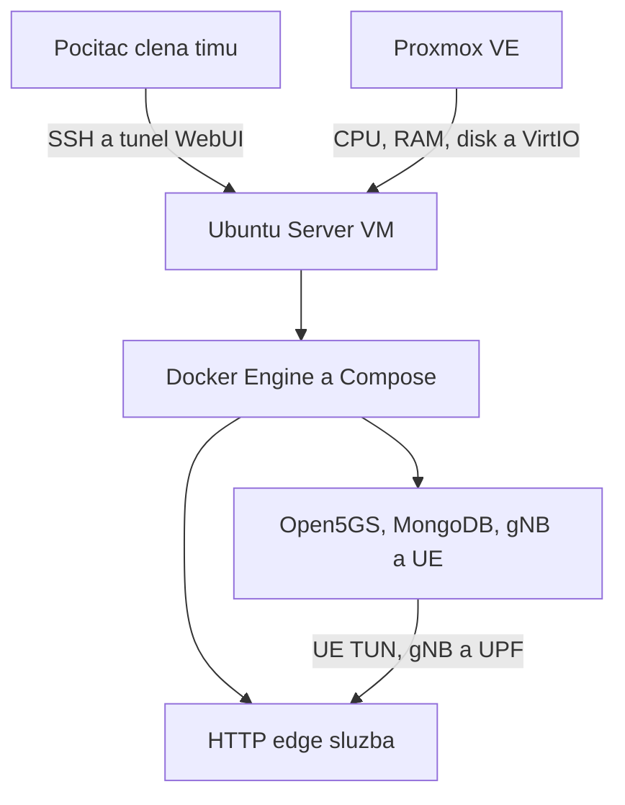

# Prenos labu na server a Proxmox VM

Tento postup pripravuje prenos existujuceho labu s jednym UE a gNB.
Overeny prenos cez UE bol vykonany vo VirtualBoxe. Nasadenie na Proxmox
zatial nebolo vykonane; lokalne testy skriptov nepotvrdzuju funkcnost na serveri.

## Cielove prostredie

Odporucany profil pre tento projekt je samostatna **QEMU/KVM VM v Proxmox VE**
s Ubuntu Server 22.04 LTS x86_64. Ponechavame rovnaku hlavnu verziu OS ako
v kontrolnej VM. Priprava sa da pouzit aj na samostatnom Linux serveri.
Pre tento prenos nepotrebujeme dalsi VirtualBox ani vnorenu virtualizaciu.

| Parameter VM | Odporucany zaciatocny profil |
| --- | --- |
| CPU | 4 vCPU; v hostovi zapnute VT-x alebo AMD-V |
| CPU model | `host` na jednom uzle; v klastri zvoli administrator kompatibilny model s AVX |
| RAM | 8 GiB; pocas porovnavanych merani nemenit pridelenu RAM |
| Disk | 80 GiB na SSD; aspon 15 GiB volnych pre obrazy a kompilaciu |
| Siet | Jedna VirtIO NIC na moste/VLAN urcenom administratorom, stabilna IP alebo DHCP rezervacia |
| Sprava | SSH kluc a opravnenie sudo vo VM; QEMU Guest Agent pre spravu VM |

Ide o odporucanie pre sucasny rozsah, nie o garantovane minimum ani kapacitu
pre viac UE. Proxmox host musi mat navyse prostriedky pre seba a ostatne VM.
MongoDB potrebuje AVX viditelne **vo vnutri VM**; nie kazdy virtualny
CPU model tieto instrukcie spristupni. Beh kontajnerov sam o sebe
nevyzaduje vnorene KVM.

Proxmox sluzi na vytvorenie a spravu VM. Docker a projekt instalujeme **vo VM**.
Volime VM kvoli vlastnemu jadru, SCTP, TUN a pristupu do namespace. Prenos do
LXC by pridal dalsie nastavenia zariadeni, capabilities a namespace a nepatri
do tohto overovacieho postupu.



## Co treba preniest

| Cast | Sposob prenosu | Dovod |
| --- | --- | --- |
| Kod a konfiguracie | Git, presny commit | Rovnaky postup a verzia aplikacii |
| `.env` | Sukromne cez SSH/SCP, prava 600 | UE musi pouzit existujuce kluce |
| Databaza `open5gs` | `mongodump` / `mongorestore` | Ucastnik, stav autentifikacie a ucty WebUI nie su v Gite |
| Docker obrazy | Archiv existujucich obrazov | Rovnaky obsah obrazov, bez zavislosti od posunu tagov |
| Vysledky `results/` | Osobitny archiv, volitelne | Historicke dokazy zostanu oddelene od merani servera |

Nekopirujte zivu adresarovu strukturu `/var/lib/docker` ani surovy zvazok
MongoDB pocas behu databazy. Novy server nedostane data len prikazom `git clone`.
Zaloha databazy aj `.env` obsahuju autentizacne udaje; patria do sukromneho
prenosu a nie do PR alebo prilohy verejneho issue.

## 1. Priprava cielovej VM

Administrator vytvori VM podla profilu a zabezpeci SSH, DNS a odchadzajuci
pristup na internet. Vo VM nainstalujte nastroje z casti 1 hlavneho README
a Docker Engine, Buildx a Compose z oficialneho repozitara Docker.
Nasledujuci blok predpoklada uz nainstalovany Docker. Pred startom QEMU
Guest Agent zapnite jeho podporu v nastaveniach VM v Proxmox.
Ako bezny pouzivatel vo VM vykonajte:

```bash
sudo apt-get update
sudo apt-get install -y git python3 curl ca-certificates build-essential iproute2 iputils-ping util-linux coreutils kmod qemu-guest-agent
sudo systemctl enable --now docker
sudo systemctl start qemu-guest-agent
sudo modprobe tun
sudo modprobe sctp
printf 'tun\nsctp\n' | sudo tee /etc/modules-load.d/open5gs-lab.conf >/dev/null
```

Posledny subor zaviedie moduly pri dalsom starte. QEMU Guest Agent treba
zapnut aj v nastaveniach VM v Proxmox; na samostatnom fyzickom serveri
sa nepouziva. Ak `modprobe` zlyha, nepokracujte v spustani kontajnerov;
administrator musi preverit jadro VM a dostupnost jeho modulov.

Siete `172.18.0.0/24` a `10.45.0.0/16` musia byt dostupne pre lab bez
kolizie s VLAN, LAN, VPN, hostovskymi trasami a cudzimi sietami Docker.
Vnutorne adresy su vo viacerych konfiguraciach; pri kolizii nerobte jednu
nahodnu nahradu v Compose. Najprv dohodnite iny adresny plan a zmente vsetky
suvisiace konfiguracie aj meracie skripty v samostatnej uprave.

V tomto scenari gNB, UE, jadro a edge bezia v rovnakej VM. Proxmox ani
externy firewall preto nepotrebuje publikovane porty 2152, 38412, 8805,
27017 alebo 8080 pre tento lab. Sprava prebieha cez SSH do VM. WebUI je
publikovane na `127.0.0.1:9998` vo VM; Docker porty mozu obchadzat pravidla
UFW, preto ich neotvarame na vsetky rozhrania.

## 2. Priprava zdrojovej VM na prenos

Tieto prikazy vykonajte **v povodnej Ubuntu VM**, ked neprebieha meranie.
Najprv ulozte sledovane zmeny do commitu a overte, ze overeny commit je
dostupny v spolocnom Git repozitari. `.env` a zalohy zostanu mimo Gitu.

Zastavenie labu umozni export bez zapisov Open5GS a WebUI. Zastavene
kontajnery a zvazky ostanu zachovane. Potom spustite iba MongoDB:

```bash
cd ~/open5gs-ueransim-lab &&
git status -sb &&
git diff --quiet HEAD -- &&
mkdir -p results &&
(
  set -e
  exec 9>results/.compose-up.lock
  flock -n 9 || exit 1
  sudo docker compose -f compose.yaml -f compose.edge.yaml stop &&
  sudo docker compose up -d --no-build --wait --wait-timeout 90 mongo
) &&
bash scripts/backup-mongo.sh
```

Skript sa deli o zamok s meraniami a startom. Odmietne export, ak bezi ina
sluzba tohto projektu. Vypise cestu noveho adresara, napriklad
`.../backups/mongo-YYYYMMDD-HHMMSS-XXXXXX`. Nastavte premennu na **skutocnu** cestu:

```bash
BACKUP_DIR="$HOME/open5gs-ueransim-lab/backups/SEM_VLOZTE_NAZOV_NOVEJ_ZALOHY"
install -m 600 .env "$BACKUP_DIR/lab.env"
```

Priprava sluzieb aj export pouzivaju rovnaky zamok, ale kazdy ho ziskava
samostatne, aby nevznikol vnoreny zamok. Medzi tymito krokmi nespustajte
iny start labu; ak sa tak stane, export odmietne beziacich klientov.

Pridajte obrazy pouzivane rovnakou konfiguraciou. Archiv zachova tagy aj
lokalne zostaveny UERANSIM. Prikazy v zatvorkach bezia v samostatnom shelli;
pri chybe sa archiv neoznaci za dokonceny:

```bash
(
  set -euo pipefail
  sudo docker compose -f compose.yaml -f compose.edge.yaml config --images > "$BACKUP_DIR/images.txt"
  sort -u "$BACKUP_DIR/images.txt" -o "$BACKUP_DIR/images.txt"
  mapfile -t LAB_IMAGES < "$BACKUP_DIR/images.txt"
  test "${#LAB_IMAGES[@]}" -gt 0
  sudo docker image save "${LAB_IMAGES[@]}" | gzip > "$BACKUP_DIR/images.tar.gz.partial"
  gzip -t "$BACKUP_DIR/images.tar.gz.partial"
  mv "$BACKUP_DIR/images.tar.gz.partial" "$BACKUP_DIR/images.tar.gz"
  cd "$BACKUP_DIR"
  sha256sum lab.env images.tar.gz >> SHA256SUMS
  sha256sum --check SHA256SUMS
)
```

Kompresia moze chvilu trvat. Existujuce obrazy sa z Dockeru neodstrania.
Ak overeny commit nie je dostupny na GitHub, mozete v tejto faze navyse
vytvorit `git bundle create "$BACKUP_DIR/source.bundle" HEAD` a preniest
ho sukromne; po prenose inicializujte repozitar a nacitajte `HEAD` z tohto
bundle namiesto vyberu commitu z GitHub. Bundle nenahradza `.env` ani databazu.

Zdrojovy lab mozete po exporte opat spustit prikazom `bash scripts/compose-up.sh`
a prikazom pre edge z casti 5. Zaloha je stav k okamihu exportu; dalsie zmeny
zdrojovej databazy sa do nej automaticky neprenesu.

## 3. Sukromny prenos a kod na serveri

Na cielovej VM vytvorte `~/lab-transfer` s pravami 700. Zo zdrojovej VM
prenesiete cely adresar zalohy cez SSH (dosadte prihlasenie a IP servera):

```bash
ssh labadmin@SERVER_IP 'mkdir -p ~/lab-transfer && chmod 700 ~/lab-transfer'
scp -r "$BACKUP_DIR" labadmin@SERVER_IP:lab-transfer/
```

Na cielovej VM nastavte `RESTORE_DIR` na prijaty adresar a skontrolujte sucty:

```bash
RESTORE_DIR="$HOME/lab-transfer/SEM_VLOZTE_NAZOV_PRENESENEJ_ZALOHY"
(cd "$RESTORE_DIR" && sha256sum --check SHA256SUMS) &&
cd ~ &&
git clone https://github.com/steroxmq/Open5GS_teamproject.git &&
cd Open5GS_teamproject &&
git fetch origin && git switch --detach "$(cat "$RESTORE_DIR/source-commit.txt")" &&
install -m 600 "$RESTORE_DIR/lab.env" .env &&
sudo docker image load --input "$RESTORE_DIR/images.tar.gz" &&
sudo python3 scripts/server-preflight.py
```

Pri chybe kontrolneho suctu archiv nepouzivajte. Pri `failed` v preflight
najprv odstrante konkretnu pricinu; `warning` pri RAM, CPU alebo volnom
mieste znamena odchylku od odporucaneho profilu. Preflight nevytvara siete,
kontajnery ani zaznamy v MongoDB. Kontroluje aj AVX, TUN, SCTP, pristup do
namespace, vsetky bind-mount subory a publikovane porty. Vysledok ulozi do
`results/server-preflight-*`. Klucove hodnoty sa do reportu nezapisuju.

Novy `.env` nema mat ine kluce nez prenesena databaza. Hodnotu
`WEBUI_BIND_IP=127.0.0.1` mozete ponechat alebo doplnit bez zmeny UE klucov.
Preflight vyzaduje lokalny rootful Docker: vzdialeny Docker context ani
rootless Docker neposkytuju tento overeny pristup k lokalnym PID a namespace.

## 4. Obnova iba do novej databazy cielovej VM

Pokracujte **iba na novej cielovej VM**. Zdrojovu databazu neobnovujte.
Pouzivame rovnaky ulozeny obraz MongoDB a nastroje exportu/importu, preto
prenos nekombinujte s aktualizaciou verzii databazy alebo Open5GS.

```bash
mkdir -p results &&
flock -n results/.compose-up.lock sudo docker compose up -d --no-build --wait --wait-timeout 90 mongo
```

Pred importom overte, ze novy kontajner skutocne pouziva ten isty obraz
MongoDB, z ktoreho vznikol export. Pri nezhode najprv opravte prenos obrazov:

```bash
MONGO_ID="$(sudo docker compose ps -q mongo)"
if [ "$(sudo docker inspect -f '{{.Image}}' "$MONGO_ID")" = "$(cat "$RESTORE_DIR/mongo-image-id.txt")" ]; then
  echo "OK: Obraz MongoDB sa zhoduje so zdrojom."
else
  echo "CHYBA: Obraz MongoDB sa nezhoduje. Nepokracujte v obnove." >&2
fi
```

Nova databaza moze obsahovat inicializacny ucet `admin`. Pred obnovou
vytvorime zalohu cieloveho stavu. Potom pod spolocnym zamkom overime obraz,
nepritomnost klientov a to, ze databaza je nova. Kontrola odmietne naplnenu
databazu s ucastnikmi alebo inymi udajmi a nepovoli viac uctov alebo iny ucet.
Nasledne `--drop` nahradi kolekcie obsiahnute v archive, vratane inicializacneho
uctu WebUI, ich povodnymi verziami zo zdroja:

```bash
bash scripts/backup-mongo.sh &&
(
  set -e
  exec 9>results/.compose-up.lock
  flock -n 9 || exit 1
  test "$(sudo docker compose -f compose.yaml -f compose.edge.yaml ps --status running --services)" = mongo || exit 1
  MONGO_ID="$(sudo docker compose ps -q mongo)" || exit 1
  test "$(sudo docker inspect -f '{{.Image}}' "$MONGO_ID")" = "$(cat "$RESTORE_DIR/mongo-image-id.txt")" || exit 1
  sudo docker compose exec -T mongo mongosh open5gs --quiet --eval '
const names = db.getCollectionNames().filter(n => db.getCollection(n).countDocuments() > 0);
if (names.some(n => n !== "accounts") || db.accounts.countDocuments() > 1 ||
    (db.accounts.countDocuments() === 1 && db.accounts.findOne().username !== "admin")) {
  print("CHYBA: Cielova databaza nie je nova; obnova sa nesmie vykonat."); quit(20);
}' || exit 1
  sudo docker compose exec -T mongo mongorestore --drop --stopOnError --gzip --archive \
    --nsInclude='open5gs.*' < "$RESTORE_DIR/open5gs.archive.gz"
)
```

Pri akejkolvek chybe obnovy nepokracujte v spustani UE. Existuje samostatna
zaloha cieloveho stavu; automaticke mazanie zvazkov ani opakovane prepisovanie
dat nie je sucastou postupu. Po uspesnom importe porovnajte pocty kolekcii:

```bash
sudo docker compose exec -T mongo mongosh open5gs --quiet --eval \
  'print(JSON.stringify(db.getCollectionNames().sort().map(n => ({collection:n,count:db.getCollection(n).countDocuments()}))))' \
  > "$HOME/restored-collections.json"
diff -u "$RESTORE_DIR/collections.json" "$HOME/restored-collections.json"
```

Pocty musia zodpovedat zdroju. Kontrola poctov sama nepotvrdzuje spravnost
klucov; to overi az uspesna autentifikacia a skutocny datovy prenos.

## 5. Spustenie a prijatie prenosu

```bash
bash scripts/compose-up.sh &&
flock -n results/.compose-up.lock sudo docker compose -f compose.yaml -f compose.edge.yaml \
  up -d --no-deps --no-build --wait --wait-timeout 90 edge &&
sudo python3 scripts/check-edge.py
```

Po suhlase timu vytvorte novu referencnu seriu merani na serveri. Pripravte
izolovany iperf3 3.21 pod beznym pouzivatelom, potom spustite serie postupne:

```bash
bash scripts/setup-lab-iperf3.sh &&
sudo python3 scripts/measure-compose.py &&
sudo python3 scripts/measure-http.py
```

Prenos prijmeme, ked je splnene:

- Preflight nema chybu; ulozene su commit, verzie a parametre VM.
- MongoDB obsahuje preneseneho ucastnika a funguje autentifikacia UE.
- UE -> UPF aj UE -> internet odpovedaju cez `uesimtun0` bez strat.
- HTTP pilot vrati 201, spravne udaje a potvrdi zdroj UPF po NAT.
- Nova seria TCP/UDP dokonci 12/12 behov a HTTP seria 9/9, 180 spravnych
  odpovedi a 120 potvrdenych prekryvov pri predvolenych parametroch.
- Po merani nezostane docasna HTTP trasa ani meracie procesy/listener.
- Po planovanom restarte VM zopakujeme postup spustenia a HTTP pilot.

Merania na serveri su **nova referencia**. Neocakavame identicke milisekundy
ako vo VirtualBoxe: iny CPU, hypervizor a zdielanie vykonu menia vysledky.
TCP 50 Mbit/s zostava nastavena zataz, nie maximum. Pocas serie nemenime
prostriedky VM, nerobime migraciu VM a nespustame zalohy alebo kompilaciu.

## Pristup timu a dalsi restart

Kazdy clen pouzije vlastny SSH kluc a ucet schvaleny spravcom. Administrator
nemusi vsetkym udelit pristup ku Proxmox ani neobmedzene sudo. Meranie cez
namespace vyzaduje privilegovany pristup vo VM; samotne citanie reportov nie.

Na serveri pouzivajte jednu prevadzkovu kopiu projektu. Nazov Compose projektu
`open5gs-ueransim` je pevny: dalsi klon na tom istom Docker hostovi nie je
samostatny lab a mohol by menit tie iste kontajnery a zvazok. Start, merania
a zaloha sa zamykaju cez rovnaky `results/.compose-up.lock` iba vtedy, ked
operatori pouziju rovnaku prevadzkovu kopiu. Prava k nej a k reportom nastavi
spravca; neuvolnujte prava `.env` a zaloh na citanie pre vsetkych.

Na svojom pocitaci vytvorte tunel a nechajte terminal otvoreny:

```bash
ssh -N -L 9998:127.0.0.1:9998 labadmin@SERVER_IP
```

Potom otvorte `http://127.0.0.1:9998` vo svojom prehliadaci. Ponechavame
ucet a heslo z prenesenej databazy, nie nutne povodne inicializacne heslo.

`restart: unless-stopped` samo negarantuje spravne poradie ani obnovu
registracie UE. Po restarte VM pouzite opat cast 5 so `compose-up.sh`;
obrazy netreba znovu zostavovat, databazu netreba obnovovat ani menit kluce.
Automaticky systemd start s kontrolou pripravenosti je dalsia samostatna
uloha po prijati servera; tento postup ho neinstaluje.

Povodnu VM a zalohu ponechajte do prijatia noveho prostredia. Proxmox backup
VM je dalsia vrstva ochrany; databazovy export ostava prenositelny nezavisle
od hypervizora. Nakladanie so zalohami a ich umiestnenie dohodnite so spravcom.

## Zdroje

- [Proxmox: VM a kontajnery](https://github.com/proxmox/pve-docs/blob/master/pct.adoc)
- [Docker Engine pre Ubuntu](https://docs.docker.com/engine/install/ubuntu/)
- [Docker: publikovanie portov](https://docs.docker.com/engine/network/port-publishing/)
- [MongoDB: poziadavky CPU](https://www.mongodb.com/docs/v7.0/administration/production-notes/)
- [MongoDB: export a obnova archivu](https://www.mongodb.com/docs/database-tools/mongorestore/mongorestore-examples/)
